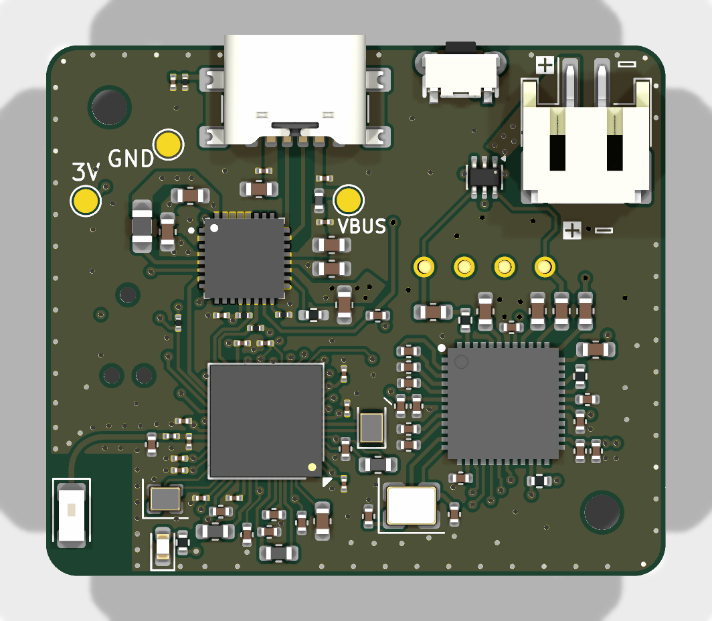
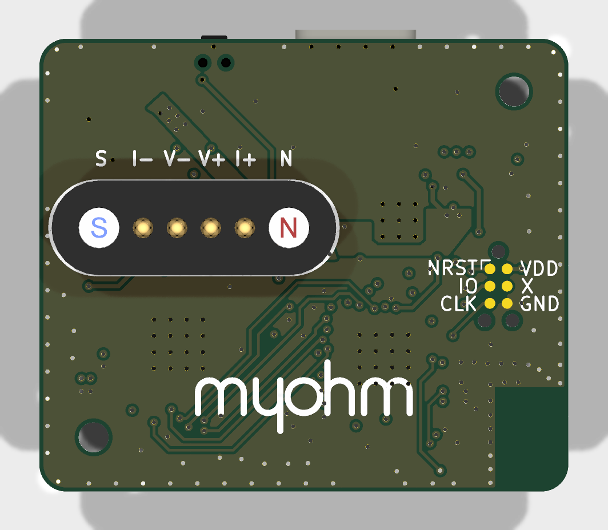

# Myohm


Research and teaching platform for bioimpedance measurement: nRF5340, AD5941 and nPM1304.

**Research instrument, not a medical device. It has not been assessed against IEC 60601-1; measure people only within an ethics-approved research protocol, on battery power, after reading [Safety](#safety). Original hardware is licensed under CERN-OHL-S-2.0 and original software under Apache-2.0; bench data under CC-BY-4.0. Third-party libraries, models and vendor code keep their original terms; see [licence scope](LICENSE.md).**

| Component side | Rear silkscreen |
| :---: | :---: |
|  |  |

## Start here

- [Licence scope](LICENSE.md)
- [Engineering audit and blockers](docs/hardware-audit.md)
- [Licensing choices and third-party provenance](docs/licensing.md)
- [Validation and release gates](docs/validation.md)
- [Hardware sources](hardware/README.md)
- [Firmware](firmware/README.md) and [BLE protocol](firmware/nrf5340_zephyr/docs/ble-protocol.md)
- [Teaching laboratory](web/README.md)
- [Local-only iOS and Android clients](mobile/README.md)
- [Published Myohm workbench](https://lab.santiagofs.com/myohm/)

## Design and bench data

| Resource | Repository |
| --- | --- |
| Main board and electrode strips (75, 100, 150 mm; 50 mm designed) | `hardware/mainboard`, `hardware/electrodes` |
| Firmware, BLE protocol, sweep 4–198 kHz | `firmware/nrf5340_zephyr` |
| Bench procedure with the AD5940 impedance test board | `tools/bench/ztest.py` |
| Bench measurements | `tools/bench/data` (CC-BY-4.0) |
| Bench error model | `tools/bench/bench_error_model.py`, output `bench_error_model.json` |
| Nodal model of contact-impedance errors | `tools/bench/mismatch_model.py` |
| Sweep quality control, R/Xc and Cole fitting | `tools/analysis/myohm_spectra.py` |
| Android and iOS clients | `mobile/` |

## Interpreting a Cole fit

The Python analysis fits the real and imaginary parts of the aggregated impedance together.
Frequencies are in Hz, resistances are in ohms, and `tau_s` is in seconds.
In the denominator `1 + (j 2π f τ)^p`, use `p = cole_exponent`.
This is the exponent called alpha in the mobile models and the [Swarthmore MATLAB implementation](https://github.com/santifs/swarthmore/blob/2d40aa04922a031763f097dffae03454ec257618/matlab/Helpers%20Across%20Projects/fitColeColeModelMultiStartLevMar.m).
The Python field `alpha` retains the BioMess dispersion convention, so `p = 1 - alpha`.

Read `quality_flag` for repeat-sweep consistency, `success` for solver termination, and
`accepted` for the fit decision. A converged fit can still fail the acceptance criteria.
`rmse_pct` is 100 times the RMS complex residual divided by mean measured magnitude.
`cost_spread` is the range of solver costs across starts. It is not a parameter uncertainty.
The mobile optimizers use magnitude residuals. New mobile fit error percentages use the RMS
magnitude residual divided by mean measured magnitude, multiplied by 100. Older mobile
records can contain an ohm-valued residual in the percentage field. The quick mobile estimate
uses the sampled reactance peak and assumes an exponent of 0.8.

An unavailable Python estimate is JSON `null`; `failure_reason` explains a rejected fit.

## Safety

- The default excitation (800 mV peak-to-peak waveform, excitation-buffer gain 2) gives 1.6 V peak-to-peak behind 1 kΩ: up to 0.57 mA rms into a short circuit, and an output outside the ±607 mV range specified for the AD5941.
- The IEC 60601-1 patient auxiliary current limit for type BF parts (100 µA rms, rising with frequency above 1 kHz) is met by the short-circuit current only above about 5.7 kHz.
- For on-body use, build the firmware with `CONFIG_MYOHM_EXCITATION_MVPP=500` (0.35 mA rms into a short circuit). The default stays at 800 mV because the published bench data were acquired with it.
- Leakage, single-fault and charger behaviour have not been measured. Disconnect USB, SWD and bench instruments before connecting a person.
- Contact impedance limits accuracy. Several kilohms at a current electrode degrade the high-frequency phase, and kilohms at a voltage electrode can invalidate the measurement. The firmware's contact check (`0x0B`, see the [BLE protocol](firmware/nrf5340_zephyr/docs/ble-protocol.md)) is experimental and not yet validated on hardware.

## Repository layout

| Directory | Contents |
| --- | --- |
| `hardware/mainboard` | KiCad 10 project, schematic, PCB and local footprints |
| `hardware/3D` | Manufacturer component models, original terms |
| `hardware/library` | Recovered editable symbols and footprints |
| `firmware/nrf5340_zephyr` | Application and out-of-tree board; nRF Connect SDK 3.3.0 |
| `web` | React teaching lab, BLE transport and offline calculations |
| `mobile` | Native iOS and Android clients; local storage and explicit export |
| `docs` | Requirements, audit, provenance and release process |
| `tools` | Repository and hardware checks; `tools/bench` bench procedure, data and models; `tools/analysis` spectral analysis |
| `reports` | Review evidence, not production manufacturing files |

The repository starts from the corrected mainboard working tree and active firmware. The source candidate excludes experimental subject data, papers, experimental mobile applications, old nRF52832 hardware and build caches. Electrode fabrication exports are experimental review artifacts; no production mainboard Gerbers are supplied. See [source manifest](docs/import-manifest.json). Legacy identifiers (`AllInOne`, `BioMess`, `biomess_nrf5340`) remain where changing them would affect hardware revision identification or software compatibility. Myohm is the project name; a branding migration must preserve the BLE wire protocol.

## Checks

```sh
python3 tools/check_repository.py
python3 tools/verify_firmware_offline.py
python3 tools/check_hardware.py  # requires KiCad 10; ERC currently fails honestly
cd web
npm ci
npm test
npm run build
```

Source: https://github.com/santifs/myohm. A clean DRC is not electrical, RF, battery or human-use validation.

La [revisión eléctrica del 20 de septiembre](docs/electrical-review.md) registra las primeras correcciones de símbolos, las comprobaciones de integridad y las decisiones de diseño pendientes.
